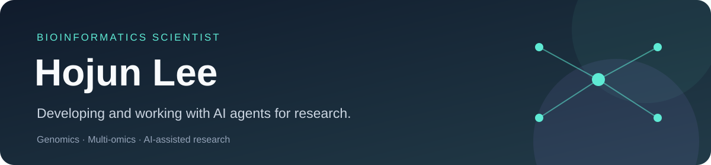

# Hojun Lee

**Bioinformatics scientist who develops and works with AI agents.**

I study biological questions through genomics and multi-omics. I develop and work with AI agents as part of that research—from analysis planning and execution to interpreting evidence.

[Research & portfolio](https://hojune-research.notion.site/24dfae63f303808093fff6e8ec820708) · [GitHub projects](https://github.com/ehojune?tab=repositories)

## Selected projects

| Project | What it does |
|---|---|
| [**LabHQ**](https://github.com/ehojune/bioinfo-team-3d) | A bioinformatics multi-agent workspace for research planning, execution, scientific review and reporting. |
| [**bioinfo-agent**](https://github.com/ehojune/bioinfo-agent) | A Claude Code skill and agent for planning, running and reviewing Nextflow and nf-core workflows. |
| [**Reason Network Chat**](https://github.com/ehojune/Reason-Network-Chat) | A local chat UI for conversations with Claude Code, Codex and other agents on Reason Network. |

Start with each project's README for installation, examples and current limitations.
